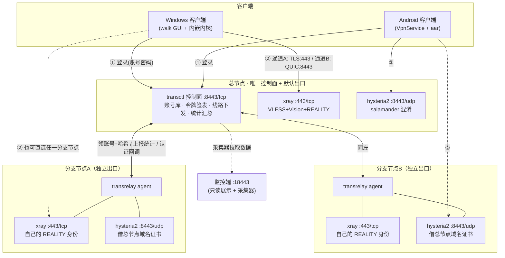
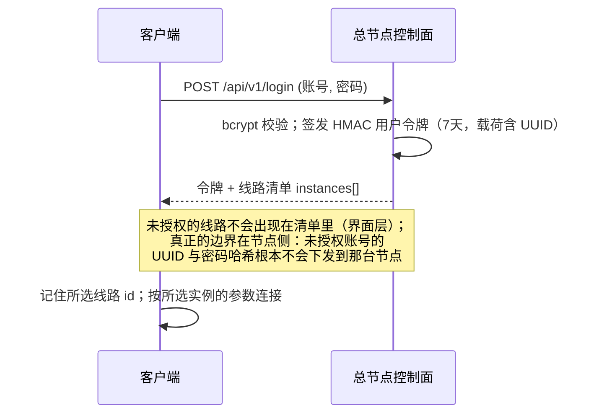

# TransProxy — 自建加密隧道代理（服务端 + Windows 客户端 + Android 客户端 + 监控面板）

自用的多节点加密代理系统：一个**总节点**负责账号、鉴权、统计与下发（同时是默认出口），
任意数量的**分支节点**以独立出口对外服务，客户端登录后按授权选择线路，从所选节点的
IP 访问互联网。

> 节点按「总节点 / 分支节点」代指。更深入的取舍与踩坑记录见
> [proxy-app/README.md](./proxy-app/README.md)。

---

## 1. 组成

| 端 | 位置 | 形态 |
|---|---|---|
| **服务端·总节点（控制面）** | `cmd/transctl` + `internal/ctl` | Go HTTP 服务：账号库、令牌签发、线路下发、统计汇总；另含 xray/hysteria 内核编排 |
| **服务端·分支节点代理** | `cmd/transrelay` | 每个分支节点上的 agent：注册自身、领账号哈希、渲染内核配置、上报统计、提供通道B 认证回调 |
| **Windows 客户端** | `cmd/tunnelclient` | walk GUI：托盘、系统代理、TUN 三种模式；内嵌 xray.exe / hysteria.exe / wintun.dll |
| **Windows 管理面板** | `cmd/tunneladmin` | 本机操作用户，经 transctl API 落到服务器 |
| **Android 客户端** | `android/` | VpnService + gomobile 内核（`android/app/libs/xraycore.aar`），与 Windows 同源逻辑 |
| **监控面板** | `monitor/monitor.py` | 跑在监控端上：用户流量、实时速率、1h/12h/24h 曲线 |

## 2. 总体架构



要点：**每个实例都是独立出口** —— 用户选「分支节点A」就从 A 的 IP 出网，选
「分支节点B」就从 B 的 IP 出网，流量不经过总节点；总节点只在控制面上
（账号、鉴权、统计）是唯一的。

## 3. 两条通道

| 通道 | 协议 | 端口 | 特点 |
|---|---|---|---|
| A | VLESS + XTLS-Vision + **REALITY** | TCP 443 | 最隐蔽：服务端没有自己的证书，无效凭据直接被转发给真站点（伪装 SNI `www.samsung.com`），线上字节就是一段真 TLS |
| B | **Hysteria2**（QUIC） | UDP 8443 | 抗丢包、弱网快：所有连接复用一条 QUIC，每条连接是独立 stream；salamander 混淆；认证失败时按 masquerade 反代真站点 |

客户端两条通道**只在内核的 `proxy` 出站上分岔**，入站、分流规则、TUN 接管完全共用 ——
分流逻辑只有一份，不存在「换条通道行为就变了」。

## 4. 运行机制（含鉴权）

### 4.1 登录与线路下发



### 4.2 数据面（以选中某分支节点为例）

```mermaid
sequenceDiagram
    participant C as 客户端
    participant N as 分支节点
    participant K as 总节点控制面

    rect rgb(235,244,255)
    Note over C,N: 通道A：REALITY（TCP 443）
    C->>N: TLS ClientHello（SNI=伪装站点 + REALITY 参数）
    N->>N: 参数不合法 → 转发给真站点（抗主动探测）
    N->>N: 参数合法 → Vision 建隧道，UUID 即身份
    end

    rect rgb(235,255,240)
    Note over C,N,K: 通道B：hysteria2（QUIC 8443）
    C->>N: QUIC 握手，携带 账号:密码
    N->>N: 回调 127.0.0.1:10087 本地校验（bcrypt，带限流）
    Note over N: 哈希是节点启动时从总节点领的，<br/>只在内存里；连打 10 次失败 → 429 + 临时封锁 10 分钟
    N-->>C: 认证通过 → QUIC streams
    end

    loop 每分钟
        N->>K: POST /api/v1/node/report（节点令牌认证）<br/>流量增量 + 访问记录行
        K->>K: 增量截断/限长校验 → 汇总进管理面板
    end
```

### 4.3 多实例与授权

- 总节点维护节点表（`nodes.json`），每节点一个 32 字节随机**节点令牌**；
  节点首次启动用令牌注册，之后凭令牌领账号与哈希、上报统计。
- 每个账号有 `allowNodes` 授权列表（面板上勾选），只有被授权账号的凭据才会下发到对应节点。
- 客户端「线路」下拉来自登录响应，**新增节点不需要重新发版客户端**。

## 5. 安全设计

| 凭据 | 谁持有 | 泄漏后 |
|---|---|---|
| 账号密码（bcrypt） | 总节点账号库 + 被授权分支节点内存 | 改密码 ⇒ 同时换 UUID 并重新下发哈希 |
| 用户令牌（HMAC，7天） | 客户端本地 | 载荷含 UUID ⇒ **改密码即刻吊销** |
| 节点令牌（32B 随机，每节点一把） | 总节点 nodes.json + 分支节点 relay.json | 只影响该节点，可单独轮换 |
| REALITY 私钥（每节点自己生成） | 各节点 | 只能冒充该节点的入口 |
| 域名证书私钥 | 总节点 + 借证书的分支节点 | 可冒充该域名 ⇒ 通道B 借证书的已知代价 |
| 面板口令（PBKDF2 20万次） | 只在监控端 | 网页上改 |
| 管理员令牌（32B） | 只在监控端，不下发浏览器 | 删文件重启即轮换 |

其他：认证回调限流（防 bcrypt 爆破/CPU 打满）；节点上报按增量截断、按行限长；
客户端令牌、注册表操作、系统代理还原等细节见 [proxy-app/README.md](./proxy-app/README.md)。

## 6. 端口约定

| 用途 | 端口 |
|---|---|
| 通道A（REALITY） | TCP 443 |
| 通道B（hysteria2）/ 控制面 API | UDP 8443 / TCP 8443（同号不同协议） |
| 节点内核统计 API（本机） | TCP 10085（总节点）/ 10086（分支节点） |
| 通道B 认证回调（本机） | TCP 10087 |
| 客户端 SOCKS / HTTP / hysteria SOCKS | 17900 / 17901 / 17902 |
| 监控端 | TCP 18443（只绑内网） |

## 7. 目录结构

```
proxy-app/
  cmd/
    tunnelclient/   Windows 客户端
    tunneladmin/    Windows 管理面板
    transctl/       总节点控制面入口
    transrelay/     分支节点 agent
    mkicon/         一张源图 → exe/Android 全套图标
  internal/
    common/         客户端↔服务端共用：配置生成（两通道在此分岔）、内核生命周期、TUN、系统代理备份还原
    ctl/            总节点控制面：账号、令牌、节点、上报、统计
    assets/         Windows 客户端内嵌内核（xray.exe/hysteria.exe/wintun.dll）与 geo 数据
  android/          Android 工程（app/ 界面与 VpnService；core/ gomobile 内核封装）
  monitor/      监控端（单文件 Python）
```

## 8. 构建

Go 工具链自备（go.mod 声明 `go 1.27`，模块名 `transproxy`）。

```bash
# 全量自检
cd proxy-app && go build ./... && go test ./...

# Windows 客户端 / 管理面板（必须 -H windowsgui，否则挂黑框）
go build -trimpath -ldflags "-H windowsgui -s -w" -o ../dist/TransProxyClient.exe ./cmd/tunnelclient
go build -trimpath -ldflags "-H windowsgui -s -w" -o ../dist/TransAdmin.exe      ./cmd/tunneladmin

# 总节点（Linux 交叉编译）
GOOS=linux GOARCH=amd64 go build -trimpath -o transctl-linux   ./cmd/transctl
GOOS=linux GOARCH=amd64 go build -trimpath -o transrelay-linux ./cmd/transrelay

# 图标：改了 app-icon.png 后必须重跑
go run ./cmd/mkicon

# Android
cd android && gradle assembleDebug
```

> 仓库内已带的 `xray.exe`/`hysteria.exe`/`xraycore.aar`/`geo*.dat` 均为公开上游产物，
> 可自行从 Xray-core / apernet/hysteria / v2fly 官方发布重新下载替换。

## 9. 部署概览

**总节点（控制面）**：`transctl` 初始化账号库与节点表 → systemd 常驻，编排本机
xray/hysteria → 配置渲染后先 `xray -test` 再原子替换 → 防火墙只放行 22/443/8443。

**接入新分支节点**（以「分支节点B」为例，全程总节点侧唯一入口）：
1. 总节点登记节点 → 渲染该节点的 `relay.json`（含节点令牌）；
2. 生成「推送密钥」，把内核二进制 + 域名证书 + `relay.json` **从总节点直推**到分支节点
   （私钥与令牌不经第三台机器）；
3. 分支节点上安装 xray / hysteria2 / transrelay 三件套，开 BBR，放行 443/tcp 与 8443/udp；
4. transrelay 自动向总节点注册并领账号 → 面板上节点变为 `ready`；
5. 在面板给账号勾选新线路授权 → 客户端重新登录即可看到并使用。

节点机差异提示：Debian/Ubuntu 的 `nobody` 组名是 `nogroup`，RHEL/CentOS 是 `nobody`；
本机防火墙二选一（ufw 或 firewalld），真正的门通常是云安全组。

## 10. 客户端行为要点

- **仅代理境外**：`geoip:cn`/`geosite:cn` 与内网直连，路由 `domainStrategy: AsIs` 防 DNS 污染误判。
- **智能优选**：先试通道 A，探测不过自动退通道 B；明确指定通道时失败就报错，不偷偷切换。
- **先探测再改系统设置**：先经本地代理探 `generate_204`，确认隧道通了才动系统代理/路由表。
- **TUN 模式**：地址/DNS/路由由客户端自己配（每步回读校验），`direct` 出站绑物理网卡防死循环。
- **系统代理三道还原保障**（真实故障修复）：落盘备份先于改注册表；RunOnce 开机自动还原；
  正常退出还原。详见 [proxy-app/README.md 第 5 节](./proxy-app/README.md)。
